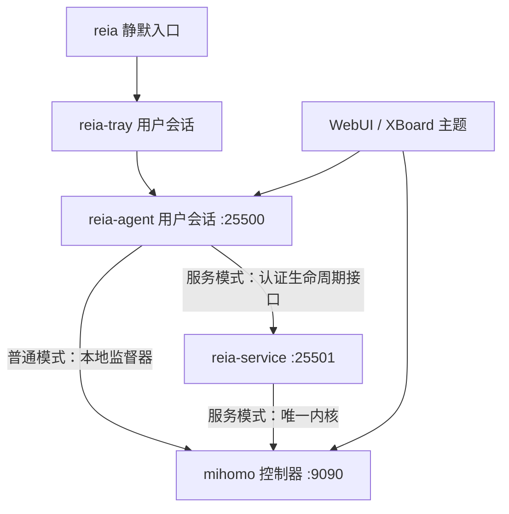

# ReiaClash 详细架构

更新日期：2026-11-19。状态与验证见 [status.md](status.md)，HTTP 合约见 [api.md](api.md)。
外部站点接入见 [前端移植指南](frontend-integration.md)；docs/examples/ 提供不依赖框架的协议接入类和最小页面，不替换宿主网站框架。

## 构建与运行

模块名为 reia-clash，go.mod 声明 Go 1.25.0。依赖版本以 go.mod/go.sum 为准，主要使用 systray、goffi、D-Bus、x/sys 和 YAML v3。
Windows 在项目目录执行 ./build.ps1，Linux/macOS 执行 sh build.sh，生成四个组件；日常启动运行 reia。
WebUI 检查脚本需要 Node.js，浏览器 DOM 验证另需 Chrome，可用 CHROME_PATH 指定程序路径。
客户端运行不依赖 Node.js；Node 仅用于这些开发验证脚本。

## 定位与四个程序

Go 客户端管理外部 mihomo；浏览器 WebUI 提供完整面板，桌面托盘提供常用入口。
面板当前为根目录 test-webui.html，未来通过既有适配入口融入 XBoard 主题。

| 程序 | 职责 | 常驻与权限 |
| --- | --- | --- |
| reia | 静默总入口，拉起托盘后返回 | 短暂运行，用户身份 |
| reia-tray | 通知、打开面板、模式/重启/退出、Agent 恢复 | 最多一份，用户会话 |
| reia-agent | 浏览器 API、设置/订阅/更新、系统代理/自启、配对、DNS 记录 | 最多一份，用户身份 |
| reia-service | 提权安装/卸载命令及 OS 管理的内核监督器 | 服务模式常驻一份，按平台授权 |
| mihomo | 实际代理、DNS、规则和 TUN | 普通与服务模式合计一份项目内核 |

Windows 构建为 exe，reia/reia-service 使用 GUI 子系统以隐藏控制台；Agent/Tray 的调试构建保留控制台。
Launcher 退出后其组件继续运行；不要把启动器短暂存在误判成第二套后台。

图中的两条内核管理路径互斥，不能同时启动两份 mihomo。

## 目录与模块

| 路径 | 主要职责 |
| --- | --- |
| cmd/reia/ | 静默启动器 |
| cmd/reia-agent/ | Agent 参数、先预占 API 端口、组装运行、兼容旧服务参数 |
| cmd/reia-tray/ | 托盘入口 |
| cmd/reia-service/ | 独立服务及特权安装/卸载入口，写启动/操作错误诊断 |
| internal/agent/ | 设置应用、订阅、服务切换、自动更新、事件、DNS、配对 |
| internal/config/ | 默认值、持久化设置、运行目录、Geo 加载方式 |
| internal/httpapi/ | 路由、loopback/CORS、请求校验、WebUI 文件服务 |
| internal/coreservice/ | 服务运行期、配置读取、本地监督器和内核就绪确认 |
| internal/mihomo/ | 配置构建、事务与验证、原生 API、监督/重启、远程生命周期 |
| internal/kernelbinary/ | 跨平台内核查找、执行权限及版本探测 |
| internal/panel/ | 真实面板 URL 规范化和默认地址 |
| internal/platform/coreservice/ | UAC/polkit/系统授权，SCM/systemd/launchd 注册与停止 |
| internal/platform/instance/ | 托盘与共享内核实例锁 |
| internal/platform/launch/ | 静默进程、浏览器打开、Windows 子进程 Job |
| internal/platform/notification/ | 系统通知及点击桥接 |
| internal/platform/network/ | 后台联网探测 |
| internal/platform/autostart/ | 当前用户登录自启 |
| internal/platform/systemproxy/ | 用户会话系统代理、备份与恢复 |
| internal/platform/privilege/ | TUN 权限检测 |
| internal/platform/signals/ | 平台退出信号 |
| internal/trayui/ | 托盘菜单、Agent 监测、面板打开、退出门控 |
| internal/update/ | 官方内核发布信息、摘要校验、归档识别与 staging |
| scripts/ | WebUI 脚本与独立浏览器验证 |
| Xboard-Theme-Aether-M3/ | 已接入 Agent 的本地 XBoard Vue 主题，保留原站点订阅/其他客户端入口 |
| data/ | 应用旁预置的 Geo 资源 |

## 监听地址与信任边界

| 端口 | 所属 | 对外范围 |
| --- | --- | --- |
| 25500 | Agent REST、握手、本地 WebUI | 127.0.0.1 / ::1 |
| 25501 | 特权服务生命周期 HTTP | 仅 127.0.0.1，独立 Bearer 密钥 |
| 9090 | mihomo REST/WebSocket | 仅 127.0.0.1，mihomo secret |
| 7890 | mihomo HTTP/SOCKS mixed 代理 | 默认 loopback，开启 LAN 后按配置开放 |

Agent 在创建 App/生成配置/启动内核前预占 IPv4 25500，服务在初始化前预占 25501。
重复 Agent 启动识别既有本项目健康接口后返回，不再因为同一 Agent 已运行而报启动失败。
未知程序占用端口仍应报告冲突；不能通过结束所有 Clash/mihomo 解决。

Agent 校验请求 Host 为 loopback 或解析结果全是允许 loopback 的别名。
CORS 支持有效 HTTPS、本机 HTTP 与本地 file 页面产生的 null Origin，并处理 PNA 请求头。
浏览器自己的本地网络授权仍需用户允许，旧式响应头不能代替浏览器授权。
握手把 mihomo 控制地址和密钥交给面板脚本，这是当前采用的直连接口设计。
服务控制密钥不返回 WebUI。

## 文件位置和内核发现

应用目录放四个程序、对应平台 mihomo、test-webui.html 与 data/。
内核使用应用程序旁的 data，即使更新后的内核位于用户 updates 目录也不改变资源目录。
go run 的二进制位于临时位置，验证预置 data 和持久服务时先构建。

用户根目录由 os.UserConfigDir() 加 ReiaClash 决定：

- Windows：%APPDATA%/ReiaClash。
- Linux：通常为 ~/.config/ReiaClash，受 XDG_CONFIG_HOME 影响。
- macOS：通常为 ~/Library/Application Support/ReiaClash。

| 文件/目录 | 用途 |
| --- | --- |
| settings.json | 持久偏好、活动/前一内核路径 |
| profile.yaml | 订阅原始配置 |
| mihomo.yaml | 客户端生成的运行配置，不能当订阅源维护 |
| mihomo.secret | mihomo 控制密钥 |
| core-service.token | Agent 与内核服务共享的控制密钥 |
| core-service.json | 服务委托描述，不能作为真实注册/运行的唯一依据 |
| system-proxy-backup.json | 本客户端修改前的系统代理备份 |
| bin/、updates/ | 旧内核缓存、版本化更新 |
| agent.log、agent-startup.log | Agent 运行及早期启动错误 |
| core-service.log | 服务内核日志 |
| core-service-startup.log | 独立服务启动错误 |
| core-service-operation.log | 特权安装/卸载错误 |
| launcher-error.log | 静默启动器错误 |

不要把订阅凭证、控制密钥、完整运行配置或用户日志正文复制进项目说明。
Windows 内核名为 mihomo.exe，Linux/macOS 为 mihomo。查找优先级：

1. 显式选择且位于受管理 updates 目录的活动更新。
2. 应用目录：先标准名，再 mihomo-/mihomo_ 开头的版本化程序。
3. 当前工作目录：同样先标准名，再版本化程序。
4. 旧活动路径、bin 缓存、上一内核。
排除归档、配置与校验文件，跨平台名称不混用。候选必须是普通文件；Unix 缺少执行位时，只对当前用户所有且文件头为本平台原生二进制的文件补用户执行位，不替脚本/异主文件改权限。之后仍须运行 -v 并识别 mihomo 输出。发现失败的各路径/原因保留到 Agent 错误事件和日志，系统服务共用查找/验证逻辑。

## Agent 维护边界

POST `/api/agent/cache/clear` 通过更新器同一把 stage 锁清理 updates 内的下载/解压临时文件，下载/校验进行中拒绝清理，并清空 Agent 内存 DNS 记录。已下载内核可能被普通进程或系统服务使用，或待切换/回滚，因此不删任何完成的版本、bin 或应用旁 data。

POST `/api/agent/logs/clear` 只原地截断 agent.log、agent-startup.log，清空 Agent 内存事件；保持文件和事件/DNS ID，现有追加日志句柄和面板游标继续有效。使用受限文件根目录访问，拒绝非普通日志文件，避免清理符号链接目标。服务日志和系统 journal 不在清理范围。

POST `/api/agent/directory/open` 只接受 cache/config，由 Agent 用户会话启动系统文件管理器，分别打开 updates/用户配置根目录；不传给特权服务，不接受网页指定任意路径。返回 202 仅表示请求已发出。三接口不改变订阅、设置、密钥、配对、服务生命周期或代理开关。

## 设置、生成配置和实际状态

订阅 URL 与成功时间由 Agent 持久化。网页按当前账号每 4 小时重新获取/推送 URL，新 URL 在下载前替换旧 URL，下载/校验失败保留可用 profile。Agent 启动时与每 12 小时独立刷新，失败 1～30 分钟退避，不依赖网页，不新增系统定时任务。订阅下载标识为 Clash.Meta，以取得兼容的 YAML；仍保留公网地址、重定向与大小限制。

Agent 订阅更新使用 subscriptionMu 串行，保存新 URL 与服务切换协调，应用阶段使用 serviceMu；内核 Manager 增加 profileMu 保护 profile/runtime 临时文件事务。设置/Geo 从事务锁内读取最新 profile，失败回滚偏好时保留订阅 URL/成功时间，防止后台刷新与网页控制相互覆盖。刷新状态只返回是否有 URL、时间、忙碌和概括错误；URL/token 不进入状态日志。细节见 [主题与订阅同步](xboard-integration.md)。

新配置默认总开关关闭、勾选 TUN、系统代理偏好关闭、规则模式、`mips` 协议栈、Geo 低内存开启。继续读取已有配置保存的偏好。
偏好与实际状态分开：Enabled/UseTun 不足以证明已接管，UI 应读取 real-status。
TunAuthorized 仅是运行期值，不写 settings.json。

生成器保留订阅节点/规则/DNS/提供器，接管监听、控制密钥、模式、TUN、Geo loader 等顶层键，避免重复键覆盖。
TUN enable 取决于 Enabled、UseTun 与运行期权限，stack 支持 mixed/gvisor/system/mips。Agent 验证 `tun_device` 的平台格式并写入 `tun.device`。留空由内核选择网卡名。网卡名通过 `real_tun_device` 展示，进程和系统服务使用项目自身的身份。[Mihomo TUN 文档](https://wiki.metacubex.one/config/inbound/tun/)
Geo 低内存分别生成 memconservative 或 standard，订阅不能覆盖这个客户端开关。
LAN 开关影响代理监听，不改变控制 API 的 loopback 边界。
模式、LAN 和活动 TUN 设置先更新持久化配置，再通过 `PATCH /configs` 热应用。更改 TUN 可能重建网卡并短暂中断接管。Agent 通过 `GET /configs` 核对实际状态并处理回滚；暂停时，TUN 配置保存到文件供下次启用。系统代理偏好由桌面适配层处理。就绪内核通过 `PUT /configs?force=true` 解析并加载更新后的订阅；失败时恢复原订阅文件和运行配置。控制器不可达时，由监督器从已校验的配置启动或重启。[Mihomo API](https://wiki.metacubex.one/api/) · [v1.19.34 实现](https://github.com/MetaCubeX/mihomo/blob/v1.19.34/hub/route/configs.go)

出口 IP 查询由 Agent 请求 `https://1.1.1.1/cdn-cgi/trace`。接管开启时经过本机 `7890` 的 Mihomo HTTP 入口，当前模式和规则决定出站。暂停时直接查询。只解析 `ip`、`loc` 和 `colo`。主题按路由状态刷新并取消过期探测，旧 Agent 使用浏览器直接请求 Trace。 [Cloudflare `/cdn-cgi/` 文档](https://developers.cloudflare.com/fundamentals/reference/cdn-cgi-endpoint/)

本地监督器在启动前检查端口，并处理崩溃退避、重启、日志和待更新内核回滚。
总开关关闭表示不接管系统流量，不等于监督器或代理监听进程必须退出。
Geo 模式修改也可能在代理暂停时重启已运行监督器。

## Linux unit 格式和坏单元修复

WorkingDirectory 使用原样绝对路径，仅将 `%` 写成 `%%`，不添加 ExecStart 的参数引号或 `$` 转义。systemd 的工作目录解析器直接检查绝对路径，不执行参数去引号；旧实现的前导引号触发 bad unit file setting。ExecStart 仍按独立参数转义。依据：[systemd 工作目录解析源码](https://github.com/systemd/systemd/blob/v257/src/core/load-fragment.c#L2383) 和 [systemd.exec](https://www.freedesktop.org/software/systemd/man/latest/systemd.exec.html#WorkingDirectory=)。

systemctl show 同时读取 LoadState、ActiveState、FragmentPath、LoadError。坏设置、加载错误、masked 单元仍计为已注册并展示错误；active/activating/reloading/deactivating 均防止启动第二个本地监督器。修复/卸载先 disable，再 stop；stop 因坏单元报错时，必须另外确认 ActiveState 为 inactive/failed 才能继续，未知/存活状态保持失败。继续拒绝覆盖不带本项目管理标记的 unit，安装失败保留原有回滚流程。

卸载并 daemon-reload 后，systemd 有时以 LoadError=org.freedesktop.systemd1.NoSuchUnit 表示单元已不存在，而不是仅返回 LoadState=not-found。无注册文件/加载或存活证据时，这种明确的 NoSuchUnit（包括无属性的 D-Bus 返回）是正常缺失，不阻止清委托并恢复普通内核。不能笼统忽略包含 not found 的错误：AccessDenied、总线缺失、坏单元和过渡状态仍必须保留。

## 系统服务和权限

Linux 安装前的路径预检由用户 Agent 执行：检查 reia-service、配置根目录和 token 的类型/所有者，确认程序可读/执行，以临时文件探测配置根目录与应用旁 data 的写入能力。以文件描述符执行 stat/chmod，只收紧当前用户所有的校验路径的组/其他用户写位，不遍历目录。root 所有且没有组/其他用户写位的系统服务程序可以使用；配置根目录和 token 必须属于服务用户。授权后的安装器再次校验，不在 root 身份下替用户递归修复所有者或文件权限。TUN capability 不替代服务用户所需的文件访问权。

Linux 安装/卸载命令不以 root 在用户目录创建或删除操作诊断；通过 pkexec 返回 stderr，由 Agent 用户身份用临时文件及 rename 写入 core-service-operation.log（0600）。替换旧日志时不跟随其符号链接。Windows/macOS 原有诊断方式保持不变。测试 WebUI 将操作错误原文保留在服务设置区，供复制路径和权限信息；状态刷新不覆盖该错误。

| 平台 | 注册对象 | 授权/身份 |
| --- | --- | --- |
| Windows | SCM ReiaClashCore，显示 ReiaClash Core | 原生 `ShellExecuteExW` UAC，LocalSystem 自有进程 |
| Linux | /etc/systemd/system/reia-clash-core.service | pkexec/polkit；登录用户身份，仅 CAP_NET_ADMIN |
| macOS | /Library/LaunchDaemons/com.reiaclash.core.plist | 系统授权；launchd 守护 |

服务只管理内核，不承担当前登录用户的桌面代理设置。
Agent 自启控制的是登录后启动 reia；系统服务的自启动由 OS 服务配置管理，两者不能混用。

Windows 以程序句柄解析真实可执行路径，适配可以访问文件但无法逐级枚举父目录的账户，并保留应用旁 `data/`。Agent 用原生 `runas` 启动专用授权程序，等待其进程句柄结束后再核对 SCM 状态。SCM 的状态与配置分别使用最小查询权限读取。 [SHELLEXECUTEINFOW](https://learn.microsoft.com/en-us/windows/win32/api/shellapi/ns-shellapi-shellexecuteinfow)

启用/修复服务的主要步骤：

1. 检查已找到可用内核并准备控制密钥。
2. 如果当前是普通监督器，先 Shutdown 等待内核退出和实例锁释放。
3. 调用特权安装器；已是服务模式时不在 UAC 确认前预先关闭远程内核。
4. Windows 禁用旧服务启动和失败恢复，停止旧服务，清理确切归属的遗留 helper/内核，再更新注册并启动。
5. 服务进程启动本地监督器，确认自己的内核运行后才宣布 SCM Running。
6. Agent 检查实际注册和运行状态、写入委托记录、连接认证端点，等待内核就绪。
7. 失败时返回具体错误；Windows 安装失败会抑制错误重试，避免循环抢端口。

Windows START_PENDING 不接受常规 STOP；清理代码使用从已确认 SCM 自有进程打开的稳定句柄处理。
不能仅检查进程名后 taskkill。归属要匹配程序路径、配置参数、创建时间；CIM/FILETIME 时间比较统一到微秒，防止误判和 PID 复用。

卸载服务先停止/移除真实注册，再核对实际状态。仍注册、运行或无法确认时不启动普通内核。
成功后清服务委托、关闭 TUN、重新生成配置，切回普通监督器；若未保留系统代理接管则关闭总开关。
取消授权或卸载失败不能把仍存活的服务当成已清理。

启动发现服务已注册但委托标记缺失/损坏时，恢复记录或保留不可用委托供修复，不应回退另起本地内核。
未注册且认证端点不可达的旧记录才允许普通模式回退；可达旧 helper 保留以供迁移。

## 单实例、子进程归属与退出

托盘用 OS 锁排重；Agent/服务用预占控制端口防止初始化并发；本地与服务监督器共用数据目录对应的 kernel 锁。
Windows 用跨身份可访问的命名锁，Unix 用该数据目录中的文件锁，不能依赖普通用户和服务各自的默认用户目录。
Windows 使用 `CreateMutexExW` 仅请求 `SYNCHRONIZE`，受限客户端可在同一个锁上识别当前所有者，普通与服务内核继续使用同一锁名。 [CreateMutexExW](https://learn.microsoft.com/en-us/windows/win32/api/synchapi/nf-synchapi-createmutexexw)
Shutdown 先结束监督器/子进程、释放锁，再完成交接。锁释放由 OS 负责，不能删除锁文件来强行接管。

Windows 子进程用 KILL_ON_JOB_CLOSE，Linux systemd 用 KillMode=control-group，macOS launchd 保留进程组清理。
旧版无 Job 的遗留进程通过特权迁移清理；新服务不能只因为某个旧内核控制端口可访问就宣布自己就绪。

| 操作 | 普通模式 | 服务模式 |
| --- | --- | --- |
| 退出客户端/托盘 | 恢复本项目代理备份，退出 Agent/托盘并停内核 | 允许保留 Agent API 和内核服务，或授权卸载后彻底退出，也可以取消 |
| 关闭网页标签 | 不改变后端运行 | 不改变后端运行 |
| 再次运行 reia | 建立或复用单一客户端 | 恢复托盘，复用后台 Agent 和服务 |
| 关闭服务开关 | 检查是否仍有真实注册并按需卸载 | 卸载真实服务、关闭 TUN、切回普通模式 |
| 手动重启内核 | 本地监督器重启 | 认证请求交给服务监督器 |

服务模式后台 Agent 是继续操作 WebUI 的必要部分，不是第二个内核或孤立特权 Agent。
托盘退出门控保证退出请求期间恢复线程不能再次启动 Agent。
注销服务并退出复用注册核对和配置清理，跳过普通监督器接管步骤。Agent 将服务切换和退出串行化。托盘在注销失败或用户取消时解除退出门控。

## WebUI、XBoard、配对与通知

统一图标资源在 ico/，用户原始 JPEG 只做格式转换。托盘与网页 favicon 内嵌 PNG，四个 Windows 程序在 cmd 下各带按架构选择的 .syso 资源；macOS 构建增加 .app 包装入口并由托盘设置应用图标。Linux launcher/tray 将内嵌 PNG 导出至用户 XDG 缓存，注册用户 applications 下四个 .desktop，后台角色 NoDisplay；自启与通知也使用该资源。桌面注册失败只记录诊断，不阻止代理启动；不覆盖非本项目管理的入口。详见 [图标维护](../ico/README.md)。

Aether M3 的字体加载器在开发 HTML 和 XBoard Blade 中使用同一份早期脚本。它优先解析 `custom_icon_url`，CSS 由样式表加载，WOFF2 在缓存未命中时由 `sandbox="allow-scripts"` 的 iframe 发出无凭据、无 Referer 的请求。宿主核对回传窗口和不透明源，字体解析成功后写入缓存。外链失败或超时释放加载状态，由本地字体渲染。 [HTML 沙盒规范](https://html.spec.whatwg.org/dev/iframe-embed-object.html)

组顺序取订阅 YAML 的 proxy-groups，节点默认取 all 原始顺序。用户可拖动、排序、恢复默认。
切节点只更改选中状态，保留组 DOM。规则模式隐藏 GLOBAL，全局置顶 GLOBAL，直连隐藏节点列表。
主题可设置 window.REIA_THEME.siteName 或调用 window.ReiaClashPanel.configure({siteName})；同名组在规则场景优先，GLOBAL 的全局置顶仍有效。

WebUI 周期扫描 Agent，握手持续上报包含路径/查询/片段的真实 panel_url；本地 file URL 不转写为 HTTP 测试页。
Agent 只在内存记录配对。托盘/通知打开目标优先级：

1. 最新明确配对 URL，包括 file:///。
2. 未配对，在线或检测中：next.rka.jp。
3. 未配对且明确离线：内置测试面板。
TCP 联网探测不能覆盖已配对 URL；通知保持简短，详细错误留在面板/日志。
系统通知点击动作分别由 Windows 隐藏窗口桥接、Linux D-Bus、macOS 通知中心处理。

融合主题通过 `/connections` WebSocket 读取活动连接，用连续快照计算速率，在页面内存保留最近 300 条已观察到的结束记录。单条和全部断开通过 Agent 执行，后台页面暂停采样。日志按批提交并自动重连，页面内存最多保留 500 条。根目录测试 WebUI 保留 Agent REST 轮询和原筛选范围。

主题将实际状态、系统状态和内核详情独立提交。设置写操作共享页面级锁，覆盖在途旧状态读请求，结合 Agent 返回的设置与新的真实状态恢复控件。内核未就绪时，页面在前台加快状态查询，不等待代理、连接等附属数据返回。
DNS 记录来自认证 debug 日志流和手动查询，最多 200 条，仅本次 Agent 内存；不要当成完整 DNS 审计。
日志流重连不应改变控制台日志级别。

## 更新与发布边界

更新器读取官方 mihomo release，验证 SHA-256，再按可执行内容识别 ZIP/GZIP/TAR/TAR.GZ/TGZ 中的内核。
包内程序可带版本名或处于嵌套目录，不能硬编码只找根目录 mihomo.exe。
包内服务单元、脚本和配置不作为安装指令执行；提取程序还需通过 -v，歧义/损坏/不兼容返回错误。
Windows x64 安装包由 `build-installer.ps1` 读取 `installer/`（兼容 `installler/`）完整生成。7-Zip 固实归档以原字节嵌入安装程序，Inno Setup 在安装时将档案展开到用户选择的目录，并记录卸载文件。四个 ReiaClash 程序、mihomo、`test-webui.html` 和预置 `data/` 保持原相对位置。桌面和开始菜单快捷方式均指向 `reia.exe`。

安装程序默认按用户安装，服务注册与系统授权仍由客户端在使用 TUN 等功能时处理。Agent/Tray 自更新和平台签名流程尚未提供。Linux/macOS 服务与桌面实测范围见状态文档。
